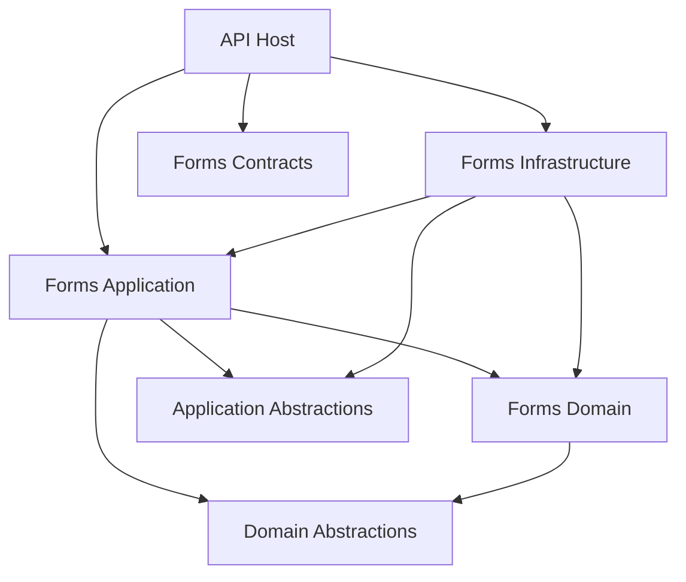

# Architecture

FormPlatform remains a modular monolith. The API is the composition root; Forms owns its domain rules, use cases, contracts, and SQL Server persistence.

## Dependency rules

- Domain depends on Domain Abstractions only. It has no EF Core, ASP.NET Core, or Infrastructure references.
- Application owns use-case orchestration and repository contracts. It depends on Domain, Forms Contracts, and the two neutral abstraction projects. Its DI extension uses only `Microsoft.Extensions.DependencyInjection.Abstractions`.
- Infrastructure implements `IFormsRepository`. EF Core and SQL Server mapping stay inside this project. Provider-specific rowversion columns are shadow properties configured here, so Domain has no SQL Server concurrency type.
- The API composes modules, applies tenant checks, maps application errors to HTTP responses, and logs unexpected exceptions without returning exception details.
- `ITenantContext` lives in Application Abstractions because application operations require it. The header implementation is registered only in Development. Other environments receive an unresolved context, and Forms routes reject those requests until production tenant resolution is connected.

## Tenant and persistence boundaries

Application use cases fail if tenant context is unresolved and always pass its tenant ID to repository queries. Infrastructure additionally checks that repository operations match the scoped tenant. EF Core global filters scope both Forms and FormVersions. A composite `(TenantId, FormId)` foreign key protects the parent relationship at the database level.

Forms use tenant-scoped unique codes. Form versions have a unique `(FormId, VersionNumber)` index. Rowversion shadow properties protect aggregate version creation and version changes from concurrent writes. The repository translates EF concurrency and SQL Server unique constraint conflicts into an application-level persistence conflict.

EF `SaveChanges` validation prevents tracked published or retired versions from changing schema or publication time. A database check constraint also keeps publication status and timestamp consistent. Schema parsing uses `System.Text.Json` in Domain and verifies metadata, field shape, and distinct nonempty identifiers.

## Extending persistence

SQL Server is the only provider currently configured. To add another provider later, implement `IFormsRepository` in an Infrastructure adapter, add that provider's configuration and concurrency mapping there, and keep Domain and Application provider-neutral. Persistence tests should run against that provider's actual relational database; do not use EF InMemory to claim relational guarantees.

## Adding a module

Add a module only when it has actual use cases. Give it its own Domain, Application, Contracts, and Infrastructure projects as needed, add an explicit `Add<Module>Application` and `Add<Module>Infrastructure` registration method, and compose them in the API. Keep references pointed inward and avoid dependencies between sibling modules.
